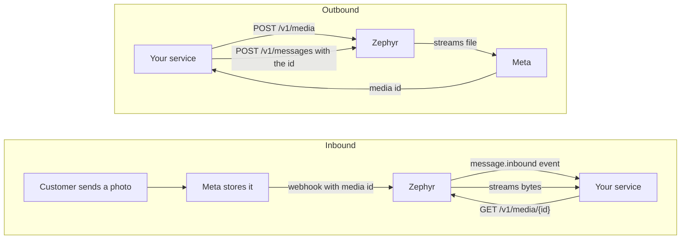

# Sending API

Zephyr sends WhatsApp messages through `POST /v1/messages` and moves media files with `POST /v1/media`, `GET /v1/media/{id}` and `DELETE /v1/media/{id}` (see [Media](#media)). It also lists failed deliveries and replays them (see [Failed events](#failed-events)). The call waits for Meta's answer and returns the WhatsApp message ID (`wamid`) or a structured error. Sending is optional and turns on only when `WA_PHONE_NUMBER_ID`, `WA_ACCESS_TOKEN`, and `API_KEYS` are configured. Without them the send and media routes do not exist and Zephyr stays receive-only. The failed-event routes need only `API_KEYS`, so a receive-only deployment can still inspect and replay failed deliveries.

## Authentication

Send an API key in the `Authorization` header.

```text
Authorization: Bearer <api key>
```

Keys come from `API_KEYS` (comma-separated, each at least 32 characters). Generate one with `openssl rand -hex 32`. Keys are compared by SHA-256 digest in constant time and are never logged. A missing or wrong key returns `401` with `WWW-Authenticate: Bearer`.

## Send a message

```http
POST /v1/messages
Authorization: Bearer <api key>
Content-Type: application/json
X-Correlation-Id: order-1234
```

```json
{
  "to": "94770000000",
  "type": "text",
  "text": { "body": "Your order has shipped." }
}
```

| Field             | Required | Description                                                                                       |
| ----------------- | -------- | ------------------------------------------------------------------------------------------------- |
| `to`              | yes      | Recipient number as 7 to 15 digits, country code first, no `+`, no spaces                         |
| `type`            | yes      | One of `text`, `image`, `video`, `audio`, `document`, `sticker`, `location`, `contacts`, `interactive`, `template`, `reaction` |
| `<type>`          | yes      | An object named after the type, in the shape Meta documents. It is passed through unchanged       |
| `phone_number_id` | no       | Must equal the configured `WA_PHONE_NUMBER_ID`. Present for forward compatibility                 |
| `correlation_id`  | no       | Your own reference. Echoed in the response and written to the logs                                |

Send an `Idempotency-Key` header to make retries safe. See the section below.

Unknown top-level fields are rejected with `400` so a misspelled field is never silently ignored. That includes `idempotency_key`: the key goes in the header, not the body. The `X-Correlation-Id` header is used when the body has no `correlation_id`, and the value is echoed in the response header.

### Success

```json
{ "wamid": "wamid.HBgLOTQ3...", "correlation_id": "order-1234" }
```

`200` means Meta accepted the message. Delivery to the phone is reported later by the inbound webhook as `message.status` events (`sent`, `delivered`, `read`, `failed`), which Zephyr forwards to your `WEBHOOK_URL`.

### Failure

```json
{
  "code": "window_closed",
  "message": "More than 24 hours have passed since the recipient last replied",
  "retryable": false,
  "meta_code": 131047
}
```

`meta_code` appears only when the error came from Meta. Use `code` and `retryable` in your logic, not the message text.

| `code`                    | HTTP | Retryable | Meaning                                                                    |
| ------------------------- | ---- | --------- | -------------------------------------------------------------------------- |
| `invalid_request`         | 400  | no        | Bad body, unknown field, or a rejected parameter. Fix the request          |
| `unauthorized`            | 401  | no        | Missing or wrong API key                                                   |
| `payload_too_large`       | 413  | no        | A message body over 1 MiB, or a media file over the limit for its type     |
| `window_closed`           | 422  | no        | The 24-hour customer service window is closed. Send a template message     |
| `recipient_undeliverable` | 422  | no        | Not a WhatsApp number, recipient blocked or opted out, or held for ecosystem health |
| `recipient_not_allowed`   | 422  | no        | Test numbers can only message recipients added in the Meta dashboard       |
| `template_error`          | 422  | no        | Template missing, not approved, wrong parameters, or paused                |
| `invalid_media`           | 422  | no        | Meta could not use the media you referenced                                |
| `sending_restricted`      | 422  | no        | Quality, policy, or account restriction on the sending number              |
| `rejected`                | 422  | no        | Meta refused the message with a code Zephyr does not classify              |
| `rate_limited`            | 429  | yes       | Meta throughput or pair limit. Wait and retry                              |
| `request_in_progress`     | 409  | yes       | Another request with the same `Idempotency-Key` is still running. Wait a moment and retry with the same key |
| `idempotency_key_reused`  | 422  | no        | The key was already used with a different message. Use a new key for a new message |
| `media_not_found`         | 404  | no        | Meta no longer has this media. Inbound media IDs expire after 7 days, uploaded ones after 30 |
| `upstream_auth_failed`    | 502  | no        | The configured access token is invalid, expired, or lacks permission. Fix `WA_ACCESS_TOKEN` |
| `sender_misconfigured`    | 502  | no        | The WhatsApp number or billing is not ready. Fix it in the Meta dashboard  |
| `upstream_unavailable`    | 502  | yes       | Meta or the network failed. Retry                                          |
| `upstream_timeout`        | 504  | yes       | Meta did not answer within 15 seconds. The message may or may not have been sent |
| `internal_error`          | 500  | no        | Unexpected gateway error. Details are in the logs, not the response        |

Zephyr does not retry sends. When `retryable` is true, your service decides whether to retry, and an `Idempotency-Key` makes that safe.

## Idempotency

A network timeout leaves you unsure whether a message was sent. Retrying blindly can message the customer twice. Send an `Idempotency-Key` header and Zephyr guarantees at most one successful send per key.

```http
POST /v1/messages
Authorization: Bearer <api key>
Idempotency-Key: order-1234-confirmation
```

Use a value that is unique per logical message, such as an order ID with the purpose, or a UUID your service stores. It can be 1 to 255 printable ASCII characters without spaces. The key is optional, and without it every call sends.

| Situation                                               | What Zephyr does                                                                          |
| ------------------------------------------------------- | ----------------------------------------------------------------------------------------- |
| First request with a key                                | Reserves the key, sends to Meta, and remembers the message ID on success                  |
| Same key and same message after a success               | Returns the original `wamid` with `Idempotent-Replayed: true`. Nothing is sent            |
| Same key while the first request is still running       | `409 request_in_progress`. Retry shortly with the same key                                 |
| Same key with a different message                       | `422 idempotency_key_reused`. Nothing is sent                                              |
| Same key after the first attempt failed                 | The key was released on failure, so the retry sends for real                              |
| Same key after `IDEMPOTENCY_TTL` (24 hours by default)  | Treated as a new key                                                                      |

What counts as the "same message": the recipient, the type, and the type-specific object, ignoring whitespace. `correlation_id` and `X-Correlation-Id` do not count, so you can change them between retries.

Only successful sends are remembered. A failure releases the key on purpose, so a retry after `window_closed` or `rate_limited` asks Meta again and gets a fresh answer instead of a stale error.

Two narrow cases can still produce a duplicate even with a key: Zephyr crashing in the moment between Meta accepting a message and Zephyr recording it (the reservation expires after 60 seconds and a retry then sends again), and a database failure while recording the key, which Zephyr logs as an error. Both are rare, and the `message.status` events tell you what actually happened.

## Examples

The `<type>` object follows Meta's documentation. Zephyr checks only the required fields shown in the validation column and passes everything else through.

### Text

```json
{ "to": "94770000000", "type": "text", "text": { "body": "Hello", "preview_url": true } }
```

### Template

Templates are the only way to start a conversation or write after the 24-hour window. The language is an object with a `code`.

```json
{
  "to": "94770000000",
  "type": "template",
  "template": {
    "name": "order_confirmation",
    "language": { "code": "en_US" },
    "components": [
      { "type": "body", "parameters": [{ "type": "text", "text": "1234" }] }
    ]
  }
}
```

### Media

Reference media by `id` (uploaded to Meta beforehand) or by public HTTPS `link`, never both.

```json
{ "to": "94770000000", "type": "image", "image": { "link": "https://example.com/photo.jpg", "caption": "Receipt" } }
```

```json
{ "to": "94770000000", "type": "document", "document": { "id": "1234567890", "filename": "invoice.pdf" } }
```

`video`, `audio`, and `sticker` use the same `id` or `link` shape.

### Location

```json
{ "to": "94770000000", "type": "location", "location": { "latitude": 6.9271, "longitude": 79.8612, "name": "Colombo", "address": "Sri Lanka" } }
```

### Contacts

`contacts` is an array and every entry needs a `name`.

```json
{ "to": "94770000000", "type": "contacts", "contacts": [{ "name": { "formatted_name": "Sam Silva", "first_name": "Sam" }, "phones": [{ "phone": "94771111111" }] }] }
```

### Interactive

`interactive` needs a `type` (`button`, `list`, `flow`, and others Meta supports) and an `action`.

```json
{
  "to": "94770000000",
  "type": "interactive",
  "interactive": {
    "type": "button",
    "body": { "text": "Confirm your order?" },
    "action": { "buttons": [
      { "type": "reply", "reply": { "id": "yes", "title": "Yes" } },
      { "type": "reply", "reply": { "id": "no", "title": "No" } }
    ] }
  }
}
```

### Reaction

`message_id` is the `wamid` of the message you are reacting to. Use an empty `emoji` string to remove a reaction.

```json
{ "to": "94770000000", "type": "reaction", "reaction": { "message_id": "wamid.HBgL...", "emoji": "<emoji character>" } }
```

## Media

Zephyr moves media between your service and Meta without storing it. Files stream straight through, so memory use stays flat for a 100 MB video and there is nothing to clean up. Zephyr needs no S3 bucket or disk space for media.



Both endpoints use the same API key as sending and exist only when sending is enabled.

### Download inbound media

When a customer sends an image, video, audio, document, or sticker, the `message.inbound` event carries the media ID inside the original message under `data.raw`, in an object named after the type:

```json
{
  "type": "message.inbound",
  "data": {
    "type": "image",
    "raw": { "type": "image", "image": { "id": "1234567890", "mime_type": "image/jpeg", "sha256": "..." } }
  }
}
```

Fetch the bytes with that ID:

```sh
curl -H "Authorization: Bearer $ZEPHYR_API_KEY" \
  http://localhost:8080/v1/media/1234567890 -o photo.jpg
```

| Response header   | Value                                                          |
| ----------------- | -------------------------------------------------------------- |
| `Content-Type`    | The media's MIME type, or `application/octet-stream` if unknown |
| `Content-Length`  | The file size when Meta reports it                              |
| `X-Media-Sha256`  | Meta's SHA-256 of the file, so you can verify the download      |

Download soon after the event arrives. Meta keeps inbound media IDs for 7 days, and Zephyr does not keep a copy. If your service needs the file longer, store it in your own bucket when you download it. A missing or expired file returns `404 media_not_found`.

### Upload media for sending

```sh
curl -X POST http://localhost:8080/v1/media \
  -H "Authorization: Bearer $ZEPHYR_API_KEY" \
  -F "file=@invoice.pdf;type=application/pdf"
```

```json
{ "id": "9876543210", "mime_type": "application/pdf" }
```

The request must be `multipart/form-data` with a part named `file`. The part's `Content-Type` is the MIME type and is required, so `curl -F "file=@x.png;type=image/png"` sets it for you. Other form fields are ignored. The response is `201`.

Then send it by ID:

```json
{ "to": "94770000000", "type": "document", "document": { "id": "9876543210", "filename": "invoice.pdf" } }
```

Uploaded media IDs stay valid for 30 days. If you already host the file at a public HTTPS URL, you can skip the upload and send it with `link` instead.

### Delete media

```sh
curl -X DELETE http://localhost:8080/v1/media/9876543210 \
  -H "Authorization: Bearer $ZEPHYR_API_KEY"
```

The response is `204` with no body. Meta removes the file and its ID stops working, which is useful for sensitive documents you no longer want held at Meta. An ID Meta no longer knows returns `404 media_not_found`, so deleting twice is safe to treat as done. This works for uploaded and inbound media alike.

### Limits

Zephyr checks the size of an upload against the limit for its MIME type while streaming, and stops with `413 payload_too_large` as soon as the file goes over, so an oversized file is not sent to Meta in full. Meta still judges formats and returns its rejection as `invalid_media`.

| Type     | Formats                                                                  | Max size                      |
| -------- | ------------------------------------------------------------------------ | ----------------------------- |
| Image    | JPEG, PNG (8-bit RGB or RGBA)                                            | 5 MB                          |
| Audio    | AAC, AMR, MP3, M4A, OGG (Opus only)                                      | 16 MB                         |
| Video    | MP4 and 3GP, H.264 video with AAC audio                                  | 16 MB                         |
| Document | PDF, TXT, DOC, DOCX, XLS, XLSX, PPT, PPTX                                | 100 MB                        |
| Sticker  | WebP                                                                     | 100 KB static, 500 KB animated |

Any MIME type not listed above, such as a type Meta adds later, uses the 100 MB document limit. `image/webp` is treated as a sticker, since Meta accepts WebP only for stickers, so it gets the larger animated limit of 500 KB. A transfer may take up to 5 minutes. For a media ID, Zephyr accepts 1 to 128 letters, digits, hyphens, and underscores.

## Failed events

When Zephyr cannot deliver an inbound event to your `WEBHOOK_URL` after `RETRY_MAX_ATTEMPTS` attempts, the event is kept as failed for `FAILED_RETENTION` (7 days by default). Once your service is back, list the failed events and replay them.

### List failed events

```sh
curl -H "Authorization: Bearer $ZEPHYR_API_KEY" \
  "http://localhost:8080/v1/events/failed?limit=50&offset=0"
```

```json
{
  "events": [
    {
      "id": "evt_b9e1cbf95bc0903025b1c4cb6199c68f",
      "topic": "wa.inbound",
      "attempts": 8,
      "last_error": "webhook responded with status 503",
      "created_at": "2026-11-01T14:28:18Z",
      "failed_at": "2026-11-01T14:31:02Z"
    }
  ],
  "limit": 50,
  "offset": 0
}
```

The newest failure comes first. `limit` is 1 to 200 and defaults to 50, and `offset` defaults to 0. A page shorter than `limit` is the last one. `last_error` is the reason for the final attempt. It names the status code or the network error, which can include your service's host and port, and never includes the message content or your signing secret. The event body is not listed. Your service receives it again on replay.

### Replay an event

```sh
curl -X POST -H "Authorization: Bearer $ZEPHYR_API_KEY" \
  http://localhost:8080/v1/events/evt_b9e1cbf95bc0903025b1c4cb6199c68f/replay
```

```json
{ "id": "evt_b9e1cbf95bc0903025b1c4cb6199c68f", "status": "queued" }
```

The response is `202`. Zephyr resets the attempt count and the delivery worker sends the event again within about a second, with the same `X-Gateway-Delivery` ID as the first time, so your idempotent handling still applies. If it fails again, it goes through the full retry cycle and returns to the failed list.

| Status | `code`            | Meaning                                                                          |
| ------ | ----------------- | -------------------------------------------------------------------------------- |
| 202    | none              | The event is queued                                                              |
| 400    | `invalid_request` | The event ID has characters outside letters, digits, hyphens, and underscores, or `limit` and `offset` are out of range |
| 404    | `event_not_found` | No failed event has this ID. It was already replayed, still retrying, or past retention |

## What Zephyr validates

| Type                                          | Required                                           |
| --------------------------------------------- | -------------------------------------------------- |
| all                                           | `to` as 7 to 15 ASCII digits, a supported `type`   |
| `text`                                        | `text.body`, not blank                             |
| `image`, `video`, `audio`, `document`, `sticker` | exactly one of `id` or `link`                   |
| `location`                                    | numeric `latitude` and `longitude`                 |
| `contacts`                                    | non-empty array, each entry with `name`            |
| `interactive`                                 | `type` and `action`                                |
| `template`                                    | `name` and `language.code`                         |
| `reaction`                                    | `message_id`                                       |

Meta enforces everything else, such as text length, media formats, and template parameter counts, and its rejection is mapped to a code above.

## Try it

```sh
curl -i -X POST http://localhost:8080/v1/messages \
  -H "Authorization: Bearer $ZEPHYR_API_KEY" \
  -H "X-Correlation-Id: first-test" \
  -d '{"to":"94770000000","type":"text","text":{"body":"Hello from Zephyr"}}'
```

A free-form text only works to a number that messaged you in the last 24 hours. To reach anyone else, send an approved template. For a Meta test number, the recipient must also be added to the allowed list in the dashboard, otherwise you receive `recipient_not_allowed`.
