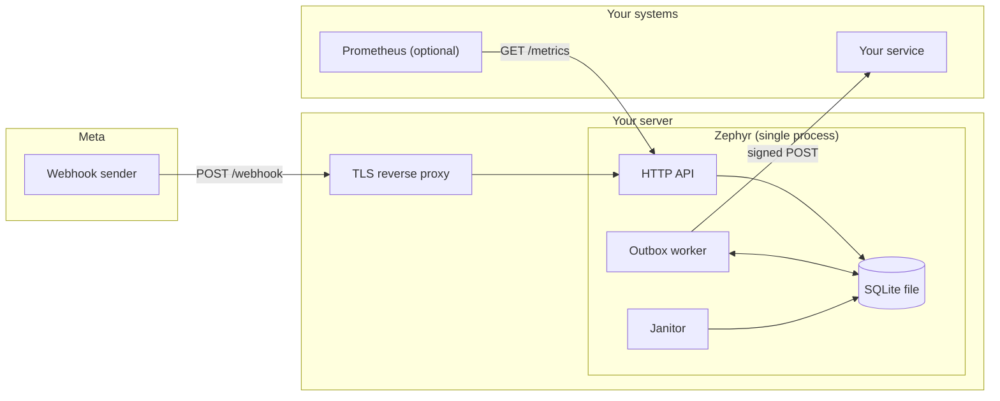
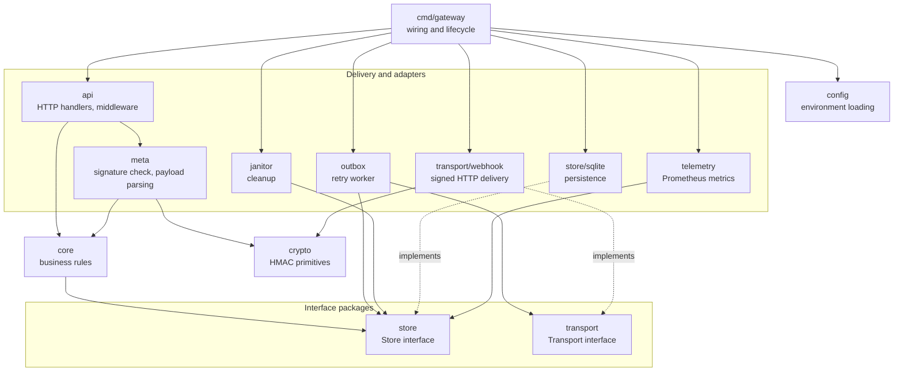
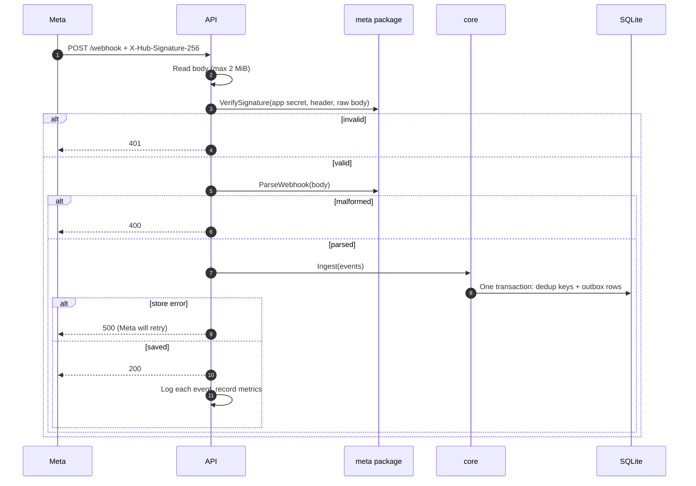
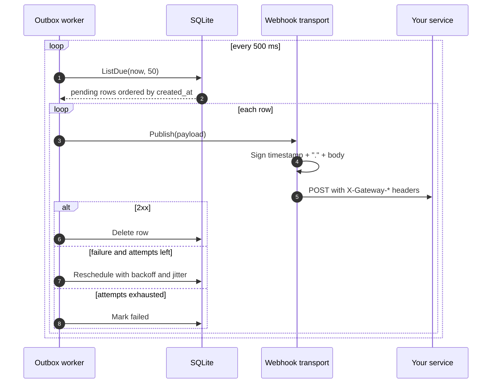
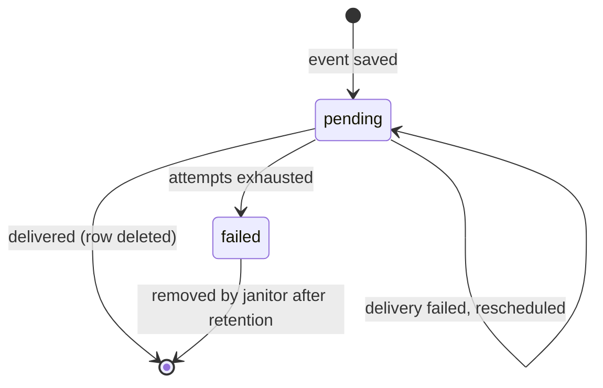
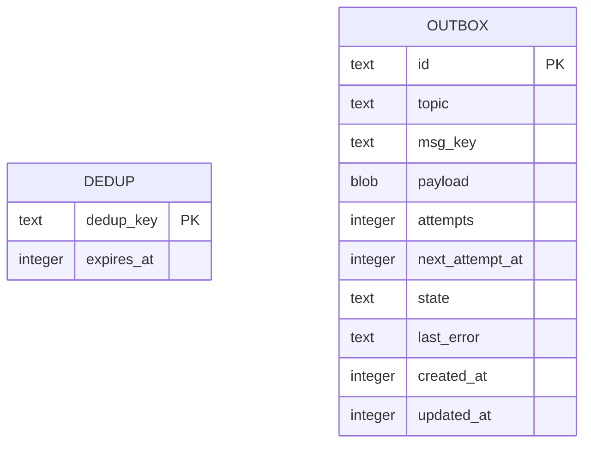

# Architecture

This document describes how Zephyr is built today (release 0.1, inbound only). The target design for later releases is in [wa-gateway-architecture.md](wa-gateway-architecture.md).

## What it does

Zephyr receives webhooks from Meta's WhatsApp Cloud API, proves they are genuine, saves them durably, and forwards them to your own HTTP endpoint with retries. It contains no bot logic and does not interpret message content.

## System context

Everything runs in one process with one SQLite file. There is no separate queue, cache, or database server.

## Layers and dependency rules

The code is layer-based. Dependencies point inward, so the business rules never depend on HTTP, SQLite, or Meta specifics.

Rules enforced by convention (see `AGENT.md`):

- `core` imports only the interface package `store`, never `store/sqlite`.
- Only `cmd/gateway` creates concrete implementations and passes them in.
- `api` and `outbox` define the small recorder interfaces they need, and `telemetry` satisfies them. Neither imports Prometheus.

## Package map

| Package                       | Responsibility                                                                                      |
| ----------------------------- | --------------------------------------------------------------------------------------------------- |
| `cmd/gateway`                 | Loads config, builds everything, starts the server, worker and janitor, handles shutdown            |
| `internal/config`             | Reads environment variables over defaults and validates them                                        |
| `internal/api`                | Gin routes: `/webhook`, `/healthz`, `/readyz`, `/metrics`. Request IDs, request logging             |
| `internal/meta`               | Verifies Meta's handshake and `X-Hub-Signature-256`, turns Meta payloads into neutral events        |
| `internal/core`               | Wraps events in envelopes, assigns IDs and topics, calls the store, reports queued versus duplicate |
| `internal/store`              | The `Store` interface and its data types                                                            |
| `internal/store/sqlite`       | SQLite implementation: transactions, dedup, outbox queries, stats, migrations                       |
| `internal/transport`          | The `Transport` interface                                                                           |
| `internal/transport/webhook`  | Delivers an event as a signed HTTP POST to your endpoint                                            |
| `internal/outbox`             | Polls for due events, delivers them, retries with backoff, marks exhausted events failed            |
| `internal/janitor`            | Periodically deletes expired dedup keys and old failed events                                       |
| `internal/crypto`             | HMAC-SHA256 signing and constant-time verification                                                  |
| `internal/telemetry`          | Prometheus metrics and the outbox-depth collector                                                   |
| `migrations`                  | Embedded SQL migrations applied at startup                                                          |

## Runtime components

One process runs three long-lived activities, all stopped together on shutdown.

| Activity        | What it does                                                    | Cadence                      |
| --------------- | --------------------------------------------------------------- | ---------------------------- |
| HTTP server     | Serves Meta's webhooks and the health and metrics endpoints     | On demand                    |
| Outbox worker   | Delivers queued events to `WEBHOOK_URL`                         | Polls every 500 ms, batch 50 |
| Janitor         | Deletes expired dedup keys and failed events past retention     | Every 1 minute               |

The worker handles one event at a time. SQLite is opened with a single connection, so all database access is serialized and there is no write contention between the API and the worker.

## Inbound path

The `200` is sent only after the transaction commits. If the process dies before that, Meta gets no acknowledgement and retries, so no event is lost. The dedup insert and the outbox insert share a transaction, so a failure cannot leave a message marked as seen without being queued.

## Delivery path and outbox lifecycle

Retry delay doubles each attempt from `RETRY_BASE_DELAY`, capped at 10 minutes, with jitter that keeps each delay between half and the full computed value. With the defaults (2 s base, 8 attempts) the seven waits between attempts add up to between about 2 and 4 minutes before the event is marked failed. Raise `RETRY_MAX_ATTEMPTS` or `RETRY_BASE_DELAY` to tolerate longer outages.

## Data model

The tables are not related by a foreign key. `dedup` remembers which Meta messages have been seen. `outbox` holds events waiting for delivery and, for a retention period, events that failed.

| Dedup key                 | Meaning                                              |
| ------------------------- | ---------------------------------------------------- |
| `msg:<wamid>`             | An inbound message, by its WhatsApp message ID       |
| `status:<wamid>:<status>` | One delivery status transition for an outgoing message |

A dedup key whose TTL has expired is treated as new, even before the janitor removes it.

## Guarantees

| Property                        | Behavior                                                                                             |
| ------------------------------- | ---------------------------------------------------------------------------------------------------- |
| Acknowledge only after saving   | Meta receives `200` only after the event is committed to disk                                        |
| No loss on crash                | Queued events survive restarts and resume automatically                                              |
| Duplicate suppression           | Repeated webhooks for the same message ID within `DEDUP_TTL` are dropped                             |
| Delivery semantics              | At least once. A crash after your service answers but before the row is deleted causes a re-delivery  |
| Ordering                        | Not guaranteed. Retries reschedule events behind newer ones                                           |
| Backpressure                    | Unbounded queue on disk. A down service builds a backlog, visible in metrics                          |

## Security model

| Boundary                    | Control                                                                                         |
| --------------------------- | ----------------------------------------------------------------------------------------------- |
| Meta to Zephyr              | HMAC-SHA256 of the raw body with the app secret, constant-time compare, 2 MiB body limit        |
| Meta verification handshake | Constant-time verify token compare                                                              |
| Zephyr to your service      | HMAC over `timestamp.body` with your signing secret, timestamp for replay protection            |
| Data at rest                | SQLite file mode `0600`, payload kept only while queued or failed                               |
| Logs                        | No message content, tokens, or secrets. Phone numbers masked. Delivery errors omit the URL      |
| Container                   | Distroless base, non-root user, read-only root filesystem                                       |

## Design decisions

| Decision                          | Reason                                                                                              |
| --------------------------------- | --------------------------------------------------------------------------------------------------- |
| SQLite outbox instead of memory   | Survives crashes and restarts, needs no extra service, matches the self-hosting goal                |
| Acknowledge Meta after saving     | Meta's retries then cover any failure before the commit                                             |
| One transaction for dedup and queue | Prevents a message being marked seen but never queued                                              |
| Signed delivery with timestamp    | Lets the receiver reject forged and replayed requests                                               |
| Layered packages with interfaces  | Core logic stays testable and transports and databases can be swapped later                         |
| Single connection to SQLite       | Removes lock contention in a single-process design                                                  |
| Pure Go SQLite driver             | Keeps the binary static, no CGO, small distroless image                                             |
