# Architecture

This document describes how Zephyr is built today: receiving WhatsApp events (release 0.1) and sending messages (release 0.2). The target design for later releases is in [wa-gateway-architecture.md](wa-gateway-architecture.md).

## What it does

Zephyr receives webhooks from Meta's WhatsApp Cloud API, proves they are genuine, saves them durably, and forwards them to your own HTTP endpoint with retries. In the other direction, your service calls `POST /v1/messages` and Zephyr validates the message, checks the 24-hour window and the rate limit, sends it to Meta, and returns the result. It can also queue the message for background delivery with retries, and with NATS it can read send requests from a topic. It contains no bot logic and does not interpret message content.

## System context

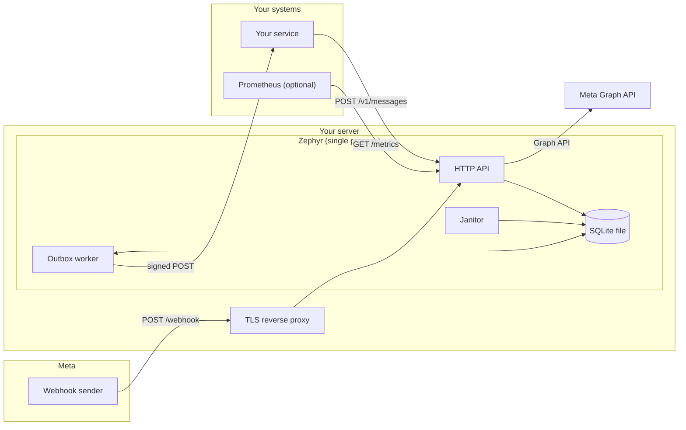

Everything runs in one process with one SQLite file. There is no separate queue, cache, or database server.

## Layers and dependency rules

The code is layer-based. Dependencies point inward, so the business rules never depend on HTTP, SQLite, or Meta specifics.

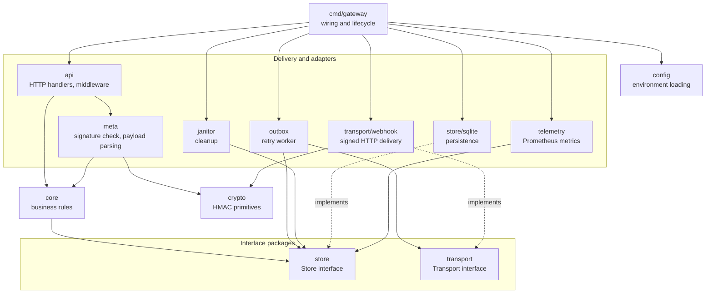

Rules enforced by convention (see `AGENT.md`):

- `core` imports only the interface package `store`, never `store/sqlite`.
- Only `cmd/gateway` creates concrete implementations and passes them in.
- `api` and `outbox` define the small recorder interfaces they need, and `telemetry` satisfies them. Neither imports Prometheus.

## Package map

| Package                       | Responsibility                                                                                      |
| ----------------------------- | --------------------------------------------------------------------------------------------------- |
| `cmd/gateway`                 | Loads config, builds everything, starts the server, worker and janitor, handles shutdown            |
| `internal/config`             | Reads environment variables over defaults and validates them                                        |
| `internal/api`                | Gin routes: `/webhook`, `/v1/messages`, `/v1/media`, `/v1/events`, `/healthz`, `/readyz`, `/metrics`. API-key auth, request IDs, request logging |
| `internal/meta`               | Verifies Meta's handshake and `X-Hub-Signature-256`, parses payloads into neutral events, and is the Graph API client that sends messages and classifies Meta errors |
| `internal/core`               | Wraps inbound events in envelopes, assigns IDs and topics, calls the store, reports queued versus duplicate. Validates outbound messages and sends them through the `Messenger` interface. Moves media and lists and replays failed events |
| `internal/store`              | The `Store`, `IdempotencyStore`, and `FailedEventStore` interfaces and their data types             |
| `internal/store/sqlite`       | SQLite implementation: transactions, dedup, outbox queries, stats, migrations                       |
| `internal/transport`          | The `Transport` interface                                                                           |
| `internal/transport/webhook`  | Delivers an event as a signed HTTP POST to your endpoint                                            |
| `internal/outbox`             | Polls for due events, delivers them, retries with backoff, marks exhausted events failed. The send worker polls for queued messages and hands each to `core` |
| `internal/transport/nats`     | Publishes events to NATS JetStream and consumes `wa.outbound`                                      |
| `internal/janitor`            | Runs cleanup tasks: expired dedup and idempotency keys, old failed events, old sessions, finished send jobs |
| `internal/crypto`             | HMAC-SHA256 signing and constant-time verification                                                  |
| `internal/telemetry`          | Prometheus metrics and the outbox-depth collector                                                   |
| `migrations`                  | Embedded SQL migrations applied at startup                                                          |

## Runtime components

One process runs three long-lived activities, all stopped together on shutdown.

| Activity        | What it does                                                    | Cadence                      |
| --------------- | --------------------------------------------------------------- | ---------------------------- |
| HTTP server     | Serves Meta's webhooks and the health and metrics endpoints     | On demand                    |
| Outbox worker   | Delivers queued events to `WEBHOOK_URL`                         | Polls every 500 ms, batch 50 |
| Send worker     | Sends queued messages to Meta and records the outcome          | Polls every 500 ms, batch 50 |
| NATS consumer   | With `TRANSPORT=nats`, reads send requests from `wa.outbound`   | As messages arrive           |
| Janitor         | Deletes expired dedup and idempotency keys, failed events past retention, old sessions and finished send jobs | Every 1 minute |

The worker handles one event at a time. SQLite is opened with a single connection, so all database access is serialized and there is no write contention between the API and the worker.

## Inbound path

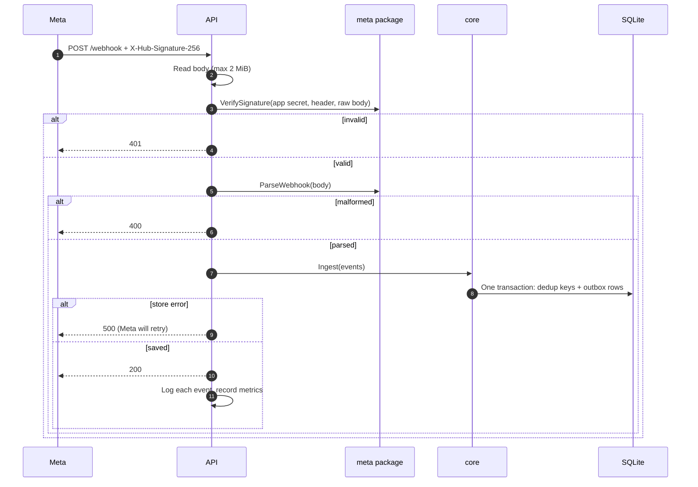

The `200` is sent only after the transaction commits. If the process dies before that, Meta gets no acknowledgement and retries, so no event is lost. The dedup insert and the outbox insert share a transaction, so a failure cannot leave a message marked as seen without being queued.

## Outbound path

Sending is synchronous and does not use the outbox. The call waits for Meta.

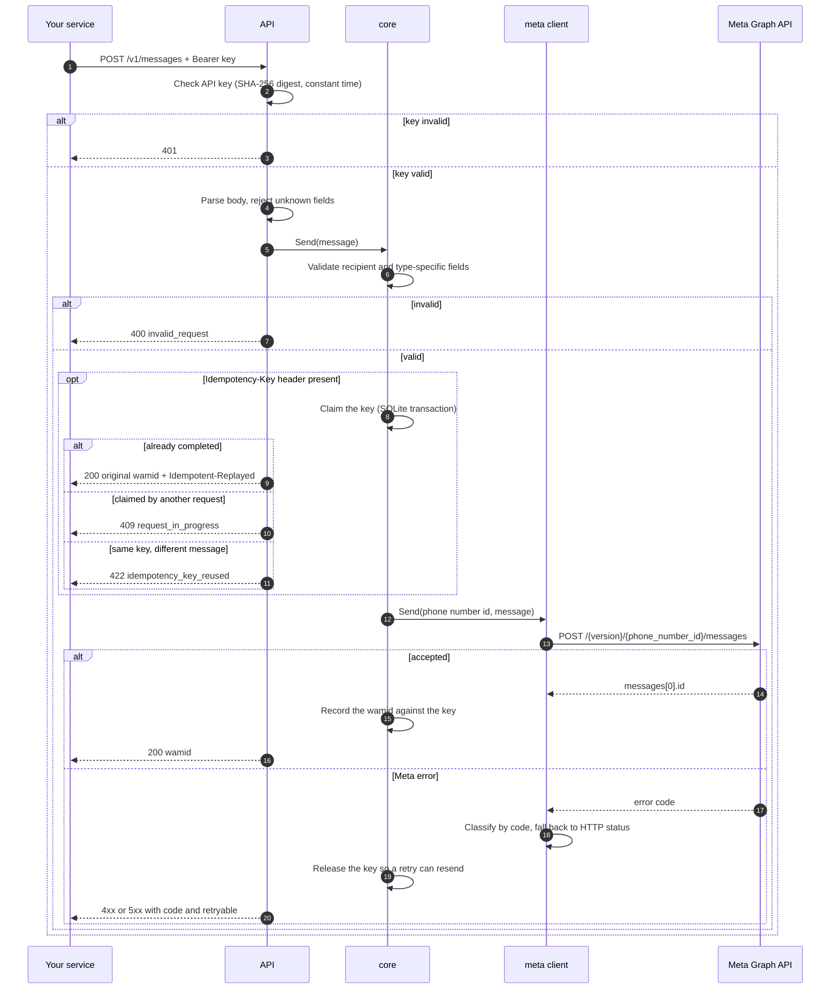

### Idempotency

Sends that carry an `Idempotency-Key` header are protected against duplicates. The key is claimed in a single SQLite transaction before Meta is called, so two simultaneous requests with the same key cannot both send: one wins and the other gets `409 request_in_progress`.

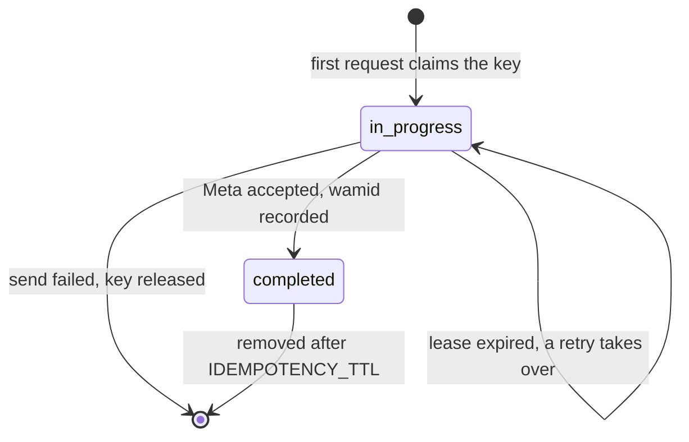

| Property                | Behavior                                                                                         |
| ----------------------- | ------------------------------------------------------------------------------------------------ |
| Race safety             | Claim happens before sending, inside one transaction on the single SQLite connection             |
| Request identity        | A fingerprint of recipient, type, and compacted content. A different fingerprint under the same key is rejected |
| What is stored          | Only the WhatsApp message ID of a successful send, for `IDEMPOTENCY_TTL`                         |
| Failed sends            | The key is released, so retries ask Meta again instead of replaying an old error                 |
| Crash during a send     | The 60 second lease expires and a retry can claim the key. If Meta had already accepted the message that retry can duplicate it |
| Settling the key        | Completing or releasing uses a context detached from the caller, so a client that disconnects mid-send still leaves the key in a correct state |
| Store unavailable       | The send is refused with `500` so that it cannot duplicate                                       |

Meta error handling follows Meta's own guidance to branch on the error `code` and not on subcodes or HTTP status. The classification is a table in `internal/meta/errors.go` and it is the single place to add a code. Codes that Meta does not list fall back to the HTTP status: `429` is rate limited, `5xx` is unavailable, `401` and `403` are authentication failures, anything else is a rejection. A response with no error object, such as a proxy's HTML page, is classified by status alone.

## Customer window

Zephyr records when each customer last wrote to you so it can refuse a free-form send that Meta would reject anyway. When an inbound `message.inbound` event is saved, the same transaction upserts a row in `sessions`, keyed by an HMAC of the phone number and the business number, keeping the latest message time. Status updates do not open a window, and a duplicate delivery from Meta does not touch the row.

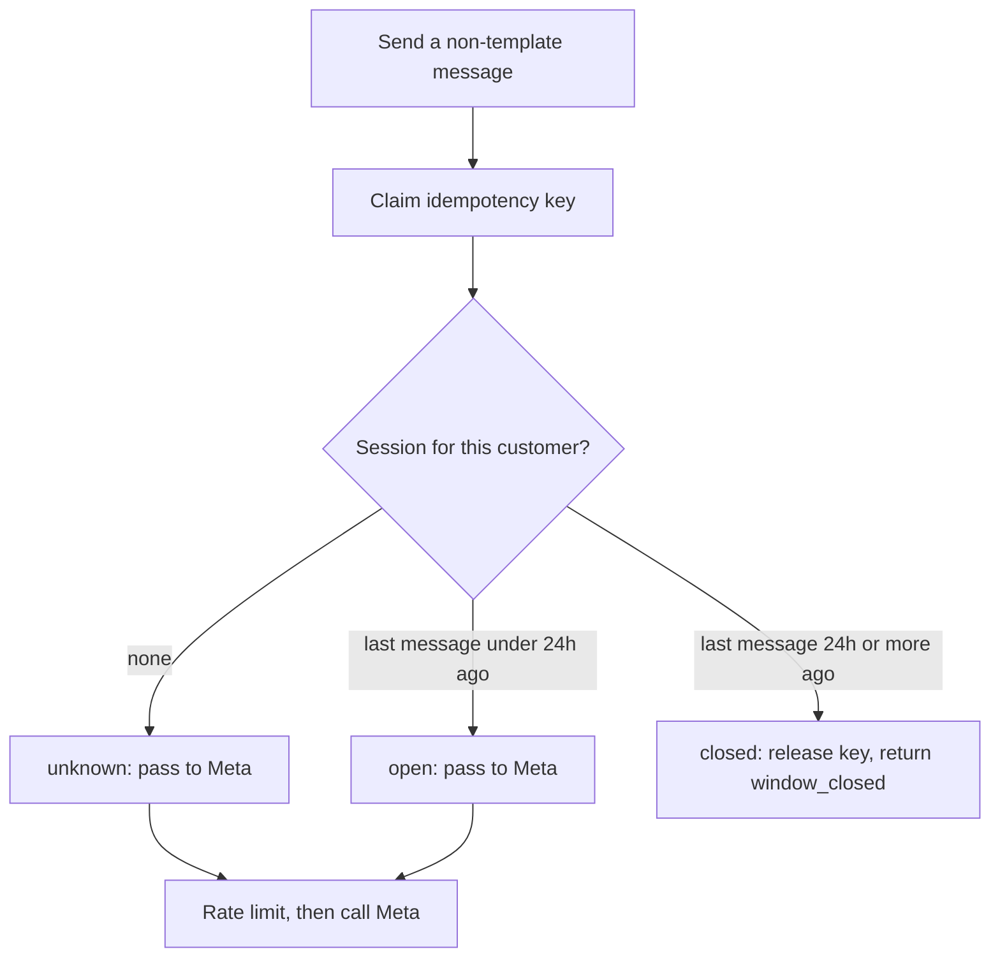

Templates skip the check. Rows are kept for 7 days, not the 24 hours the window needs, because with only 24 hours of history an expired row would vanish and look `unknown`, and the check would almost never refuse anything. A closed window is checked after the idempotency claim so a replay still returns the stored result, and the claim is released on refusal because failures are never stored.

## Rate limiting

A token bucket per WhatsApp number, holding `RATE_LIMIT_MPS` tokens that refill at that rate (80 per second by default). A send reserves a token. If the token is available within 2 seconds the send waits for it, otherwise the reservation is cancelled, so a refused call does not use up capacity, and the caller gets a retryable `429 rate_limited`. The buckets live in memory and are per process, which matches the single-instance design.

## Async and broker sends

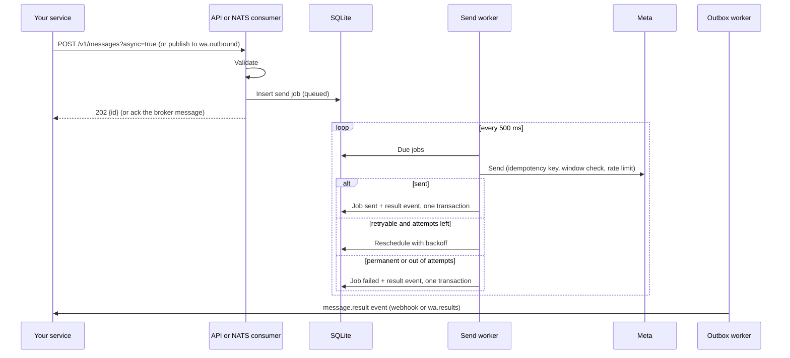

A job's outcome and its `message.result` event are written in one transaction, so a result can never be recorded without being announced, or announced without being recorded. The job keeps the message body only until the outcome is known. Every queued message has an idempotency key (the caller's, or a generated one), so a worker crash after Meta accepted a message and before the outcome was stored re-runs the job, finds the key completed, and records the original `wamid` without sending again. The outbox table is not reused for sends, because event delivery and message sending have different retry decisions and different results to record.

## Broker transport (NATS)

With `TRANSPORT=nats` the outbox worker publishes each event with `Transport.Publish` to a JetStream subject equal to its topic, using the event ID as the message ID so JetStream drops a re-publish within its duplicate window. The outbox still owns retries for publishing. In the other direction the consumer reads `wa.outbound` with a durable explicit-ack consumer and does only one thing: validate the request and put it on the send queue, then acknowledge. Everything after that is the async path above, which means a broker request and an async REST request behave identically.

| Situation                                   | Behavior                                                                  |
| ------------------------------------------- | ------------------------------------------------------------------------- |
| Request is valid                            | Queued and acknowledged                                                   |
| Request is malformed or fails validation    | A failed `message.result` is written, and the message is acknowledged so it is not redelivered |
| Zephyr cannot store the request             | Not acknowledged. Redelivered after 5 seconds, up to 10 times             |
| Broker redelivers an acknowledged message   | The idempotency key (the request's own, or one derived from the stream sequence) stops a second send |
| Broker is unreachable at startup            | Zephyr exits with an error. Docker restarts it                            |

## Media path

Media is streamed through Zephyr and never stored. There is no S3 dependency and nothing to clean up.

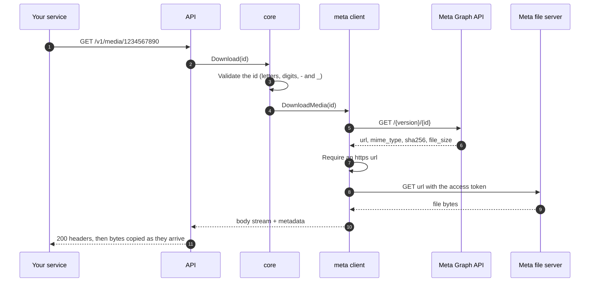

| Property                | Behavior                                                                                           |
| ----------------------- | -------------------------------------------------------------------------------------------------- |
| Memory                  | Constant. Bytes are copied from Meta to the caller in small chunks, nothing is buffered whole      |
| Upload                  | The caller's multipart body is re-encoded on the fly into Meta's multipart request through a pipe  |
| Deadlines               | The server's 30 second read and write deadlines are lifted to 6 minutes for the two media routes   |
| Size limit              | Per MIME type (image 5 MB, audio and video 16 MB, sticker 500 KB, other 100 MB), enforced while streaming so an oversized file is cut off early |
| Delete                  | `DELETE /v1/media/{id}` is forwarded to Meta and returns `204`. Nothing local changes             |
| Caller disconnects      | The request context is cancelled, which stops the transfer on both sides                          |
| A failing source        | If the caller's upload breaks, the error is attributed to the caller (400 or 413), not to Meta     |
| Interrupted download    | The status is already sent, so Zephyr logs `media stream interrupted`. The declared `Content-Length` lets the client detect the short body |
| Download URL safety     | Only `https` locations are followed, and the access token is sent only with the request to that URL |
| Filenames               | Reduced to a base name with quotes and control characters removed before they reach Meta          |
| What is not stored      | File content, filenames, and URLs. Logs carry the media ID, MIME type, and byte count only        |

## Delivery path and outbox lifecycle

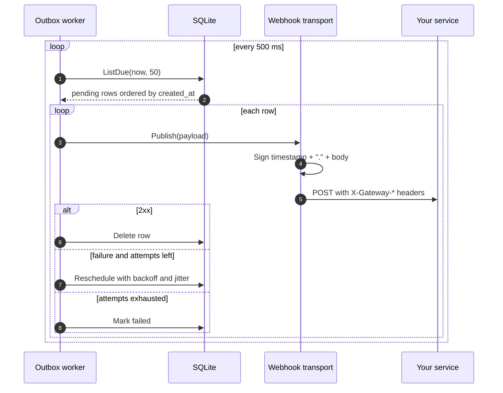

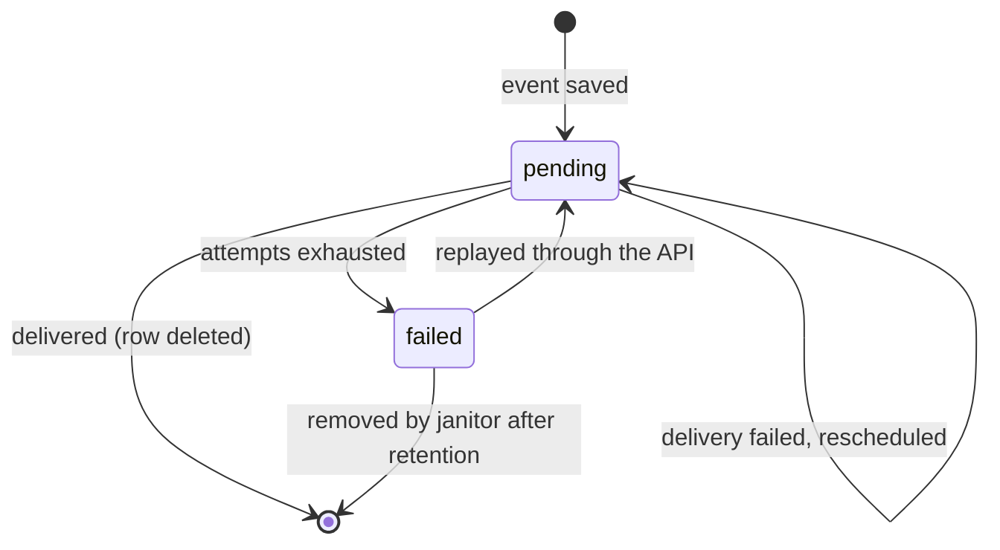

Retry delay doubles each attempt from `RETRY_BASE_DELAY`, capped at 10 minutes, with jitter that keeps each delay between half and the full computed value. With the defaults (2 s base, 8 attempts) the seven waits between attempts add up to between about 2 and 4 minutes before the event is marked failed. Raise `RETRY_MAX_ATTEMPTS` or `RETRY_BASE_DELAY` to tolerate longer outages.

### Replaying failed events

`GET /v1/events/failed` reads the failed rows, newest failure first, and `POST /v1/events/{id}/replay` sets one back to pending with zero attempts in a single conditional update (`WHERE state = 'failed'`). The worker picks it up on its next poll, so the API never delivers anything itself. The update makes a replay safe under concurrency: of two simultaneous calls for the same event exactly one succeeds and the other gets `404 event_not_found`. A replay also restarts the retention clock, because retention counts from the last state change. The event keeps its ID, so your service sees the same `X-Gateway-Delivery` value again. These routes need only `API_KEYS`, not the Meta sending settings.

## Data model

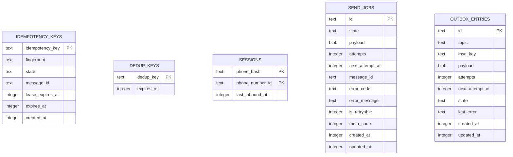

The tables are not related by a foreign key. `dedup_keys` remembers which Meta messages have been seen. `idempotency_keys` remembers successful sends by caller key. `outbox_entries` holds events waiting for delivery and, for a retention period, events that failed. `sessions` remembers when each customer last wrote, as a hash of their number, for 7 days. `send_jobs` holds queued messages with their message body, which is erased when the outcome is recorded, and then keeps only the status for `IDEMPOTENCY_TTL`.

| Dedup key                 | Meaning                                              |
| ------------------------- | ---------------------------------------------------- |
| `msg:<wamid>`             | An inbound message, by its WhatsApp message ID       |
| `status:<wamid>:<status>` | One delivery status transition for an outgoing message |

A dedup key whose TTL has expired is treated as new, even before the janitor removes it.

## Guarantees

| Property                        | Behavior                                                                                             |
| ------------------------------- | ---------------------------------------------------------------------------------------------------- |
| Acknowledge only after saving   | Meta receives `200` only after the event is committed to disk                                        |
| No loss on crash                | Queued events survive restarts and resume automatically                                              |
| Duplicate suppression           | Repeated webhooks for the same message ID within `DEDUP_TTL` are dropped                             |
| Delivery semantics              | At least once. A crash after your service answers but before the row is deleted causes a re-delivery  |
| Ordering                        | Not guaranteed. Retries reschedule events behind newer ones                                           |
| Backpressure                    | Unbounded queue on disk. A down service builds a backlog, visible in metrics                          |

## Security model

| Boundary                    | Control                                                                                         |
| --------------------------- | ----------------------------------------------------------------------------------------------- |
| Meta to Zephyr              | HMAC-SHA256 of the raw body with the app secret, constant-time compare, 2 MiB body limit        |
| Meta verification handshake | Constant-time verify token compare                                                              |
| Zephyr to your service      | HMAC over `timestamp.body` with your signing secret, timestamp for replay protection            |
| Your service to Zephyr      | API key in `Authorization: Bearer`, compared by SHA-256 digest in constant time, body limit 1 MiB |
| Zephyr to Meta              | Access token sent only to the Graph API over HTTPS, never logged or returned to callers         |
| Data at rest                | SQLite file mode `0600`, payload kept only while queued or failed                               |
| Logs                        | No message content, tokens, or secrets. Phone numbers masked. Delivery errors omit the URL      |
| Container                   | Distroless base, non-root user, read-only root filesystem                                       |

## Design decisions

| Decision                          | Reason                                                                                              |
| --------------------------------- | --------------------------------------------------------------------------------------------------- |
| SQLite outbox instead of memory   | Survives crashes and restarts, needs no extra service, matches the self-hosting goal                |
| Acknowledge Meta after saving     | Meta's retries then cover any failure before the commit                                             |
| One transaction for dedup and queue | Prevents a message being marked seen but never queued                                              |
| Signed delivery with timestamp    | Lets the receiver reject forged and replayed requests                                               |
| Layered packages with interfaces  | Core logic stays testable and transports and databases can be swapped later                         |
| Single connection to SQLite       | Removes lock contention in a single-process design                                                  |
| Synchronous sending               | The caller gets the message ID or the error in one call. The only send state is the idempotency key  |
| Claim first, then send            | Closes the race that a check-then-send design leaves open when two requests carry the same key       |
| Remember successes only           | A stored failure would replay a stale error, for example a closed window, for a full day              |
| Key in a header, not the body     | One place for the key, matching the common `Idempotency-Key` convention, and no chance of the two disagreeing |
| Content passed to Meta unchanged  | New Meta message features work without a Zephyr release. Only required fields are validated         |
| Optional sending                  | Receive-only deployments need no token or API keys and expose no `/v1` routes                        |
| Streaming media with no storage   | Meta already keeps the files, so Zephyr needs no bucket, disk, or cleanup, and stays free of media state |
| Multipart upload, MIME from the part | One obvious way to upload with `curl -F`, and the type travels with the file instead of a second field |
| Pure Go SQLite driver             | Keeps the binary static, no CGO, small distroless image                                             |
