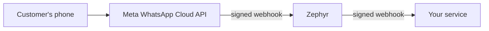

# Getting started

This guide takes you from nothing to a WhatsApp message arriving at your own HTTP endpoint through Zephyr. It covers release 0.1: receiving messages and delivery statuses. Sending messages is not available yet, so you do not need a WhatsApp access token.

## How it fits together



Zephyr sits between Meta and your service. It checks that requests really come from Meta, saves each event to disk, and forwards it to your service, retrying until your service accepts it.

## Prerequisites

- A Meta developer account and a Meta app with the WhatsApp product added
- A WhatsApp test phone number from the Meta dashboard (or a real business number)
- A public HTTPS URL that reaches Zephyr. Meta only calls HTTPS endpoints, so local development needs a tunnel such as `cloudflared` or `ngrok`
- Either Go 1.26 or later, or Docker with Compose
- An HTTP endpoint of your own to receive events (a simple script is enough to start, see step 5)

## 1. Generate secrets

Zephyr needs two secrets you create yourself. Each must be at least 16 characters.

```sh
openssl rand -hex 32   # use for META_VERIFY_TOKEN
openssl rand -hex 32   # use for WEBHOOK_SIGNING_SECRET
```

## 2. Collect values from Meta

| Value                | Where to find it                                     | Used for            |
| -------------------- | ---------------------------------------------------- | ------------------- |
| App secret           | Meta app dashboard, App settings, Basic              | `META_APP_SECRET`   |
| Verify token         | The value you generated in step 1                    | `META_VERIFY_TOKEN` |

The verify token is not issued by Meta. You invent it and enter the same value in both Zephyr and the Meta dashboard.

## 3. Configure Zephyr

```sh
make setup
```

This creates `.env` from `.env.example` and downloads Go modules. Edit `.env`:

```sh
META_APP_SECRET=<app secret from Meta>
META_VERIFY_TOKEN=<generated token>
WEBHOOK_URL=http://localhost:9000/zephyr
WEBHOOK_SIGNING_SECRET=<generated secret>
```

Zephyr refuses to start with a clear message if a required value is missing or too short.

## 4. Run Zephyr

Locally:

```sh
make run
```

Or with Docker:

```sh
make up
make logs
```

Check it is alive:

```sh
curl localhost:8080/healthz
curl localhost:8080/readyz
```

Both return a small JSON status. `readyz` also confirms the database is reachable.

Docker note: inside a container, `localhost` is the container itself. Point `WEBHOOK_URL` at a host the container can reach, for example `http://host.docker.internal:9000/zephyr` on Docker Desktop.

## 5. Start a receiver

Zephyr delivers events by POSTing JSON to `WEBHOOK_URL`. This minimal receiver verifies the signature and prints each event. Save it as `receiver.py` and run `python3 receiver.py`.

```python
import hashlib, hmac, json, os, time
from http.server import BaseHTTPRequestHandler, HTTPServer

SECRET = os.environ["WEBHOOK_SIGNING_SECRET"].encode()

class Handler(BaseHTTPRequestHandler):
    def do_POST(self):
        body = self.rfile.read(int(self.headers["Content-Length"]))
        timestamp = self.headers["X-Gateway-Timestamp"]
        expected = "sha256=" + hmac.new(SECRET, timestamp.encode() + b"." + body, hashlib.sha256).hexdigest()

        fresh = abs(time.time() - int(timestamp)) < 300
        if not (fresh and hmac.compare_digest(expected, self.headers["X-Gateway-Signature"])):
            self.send_response(401)
            self.end_headers()
            return

        print(json.dumps(json.loads(body), indent=2))
        self.send_response(200)
        self.end_headers()

HTTPServer(("0.0.0.0", 9000), Handler).serve_forever()
```

Run it with the same `WEBHOOK_SIGNING_SECRET` in its environment. Respond `2xx` only after you have safely handled the event. Anything else makes Zephyr retry. Because delivery is at least once, treat the event `id` as an idempotency key.

## 6. Expose Zephyr and connect Meta

1. Start your tunnel and note the public HTTPS URL, for example `https://abc123.example.com`.
2. In the Meta app dashboard, open WhatsApp, Configuration, Webhook.
3. Set the callback URL to `https://abc123.example.com/webhook` and the verify token to your `META_VERIFY_TOKEN`, then verify and save.
4. Subscribe to the `messages` webhook field.

When you press verify, Meta sends a `GET /webhook` request. Zephyr logs `webhook verified by meta` when it succeeds. A `403` means the token does not match.

## 7. Send a test message

Send a WhatsApp message from your phone to the business number (for a test number, first add your phone as an allowed recipient in the Meta dashboard). Within a second you should see:

1. Zephyr log: `event received` with an `event_id`, `queued`
2. Zephyr log: `event delivered`
3. Your receiver printing a `message.inbound` event

Delivery status updates (`sent`, `delivered`, `read`, `failed`) for messages sent from the business number arrive as `message.status` events.

## Day-to-day commands

| Command          | What it does                                  |
| ---------------- | --------------------------------------------- |
| `make help`      | List all targets                              |
| `make run`       | Run locally using `.env`                      |
| `make test`      | Run the test suite with the race detector     |
| `make build`     | Build `apps/gateway/bin/zephyr`               |
| `make up`        | Start Zephyr in Docker                        |
| `make up-nats`   | Also start NATS (for future broker transport) |
| `make down`      | Stop all containers                           |
| `make logs`      | Follow gateway logs                           |

## Troubleshooting

| Symptom                                           | Likely cause and fix                                                                                   |
| ------------------------------------------------- | ------------------------------------------------------------------------------------------------------ |
| Zephyr exits at startup with a config error       | A required variable is missing or shorter than 16 characters. Read the message, fix `.env`.            |
| Meta shows verification failed                    | `META_VERIFY_TOKEN` differs from the dashboard value, or the tunnel does not reach Zephyr.             |
| Log shows `webhook signature rejected`            | `META_APP_SECRET` is wrong, or a proxy altered the request body.                                       |
| Messages arrive in Zephyr but not at your service | Check `event delivery failed, will retry` logs. Your endpoint returned non-2xx or was unreachable.     |
| Docker: delivery fails to `localhost`             | Use a host address the container can reach, not `localhost`.                                           |
| Events keep failing and then stop retrying        | After `RETRY_MAX_ATTEMPTS` they are marked failed. See [limitations.md](limitations.md) for recovery.   |
| `readyz` returns 503                              | The database cannot be reached. Check the data volume and permissions.                                 |

For monitoring and tracing a specific message, see [telemetry.md](telemetry.md).
