# User flows

Each flow shows what happens, who acts, and what you can observe in logs. Log messages quoted here are the real ones Zephyr emits. For event field details see [events.md](events.md).

## Flow 1: Operator setup

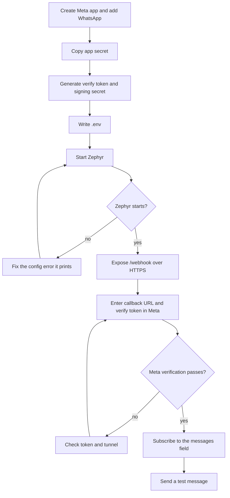

See [getting-started.md](getting-started.md) for the detailed steps.

## Flow 2: Meta verifies the webhook

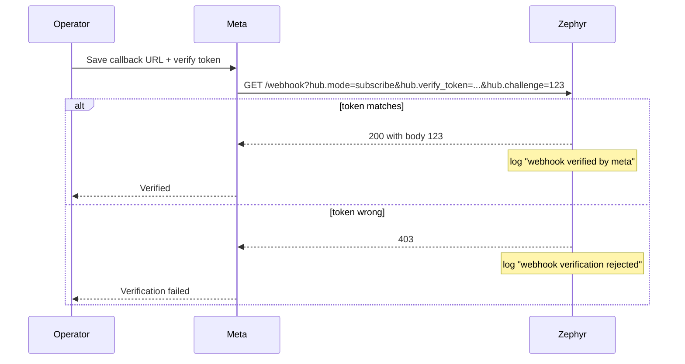

## Flow 3: A customer sends a message

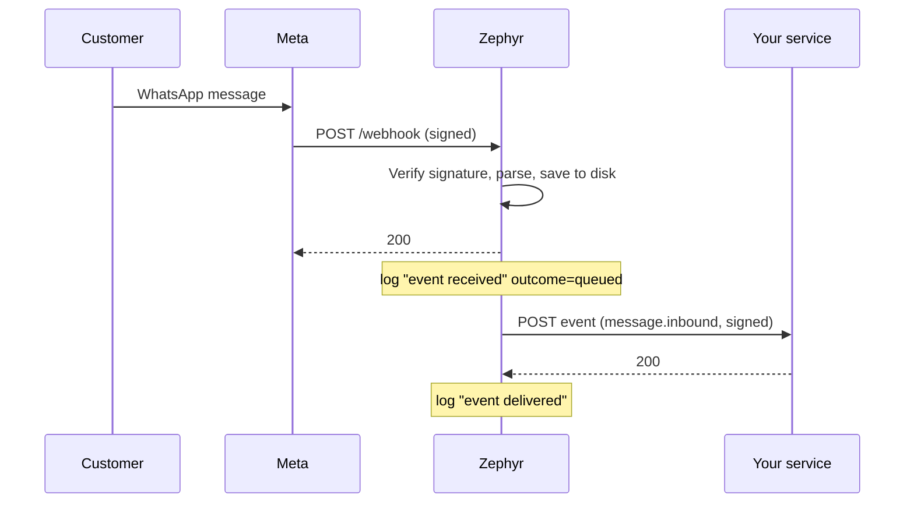

Your service receives a `message.inbound` event containing the sender, message ID, timestamp, type, and the original Meta message under `raw`. Reply logic belongs in your service, which can answer through the sending API (flow 13).

## Flow 4: A delivery status update

When a message sent from the business number is delivered, read, or fails, Meta sends a status webhook. Zephyr forwards it as a `message.status` event with `status` set to `sent`, `delivered`, `read`, or `failed`. Failed statuses include Meta's `errors`. The path through Zephyr is the same as Flow 3.

## Flow 5: Meta sends the same webhook twice

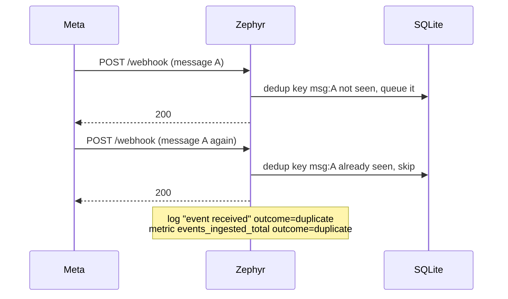

Meta always receives `200`, so it stops retrying. Your service receives the event once.

## Flow 6: Your service is down

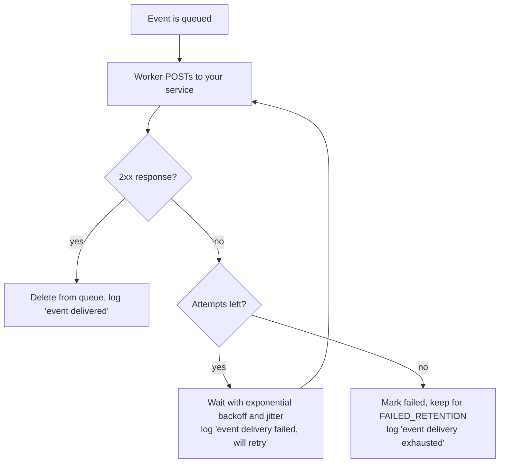

While your service is down, Meta still gets `200` because the events are safely on disk. They pile up as pending entries. Watch `zephyr_outbox_entries{state="pending"}` and `zephyr_outbox_oldest_pending_age_seconds`. When your service returns, the backlog drains in arrival order, subject to the ordering caveat in [limitations.md](limitations.md).

## Flow 7: Zephyr restarts or crashes

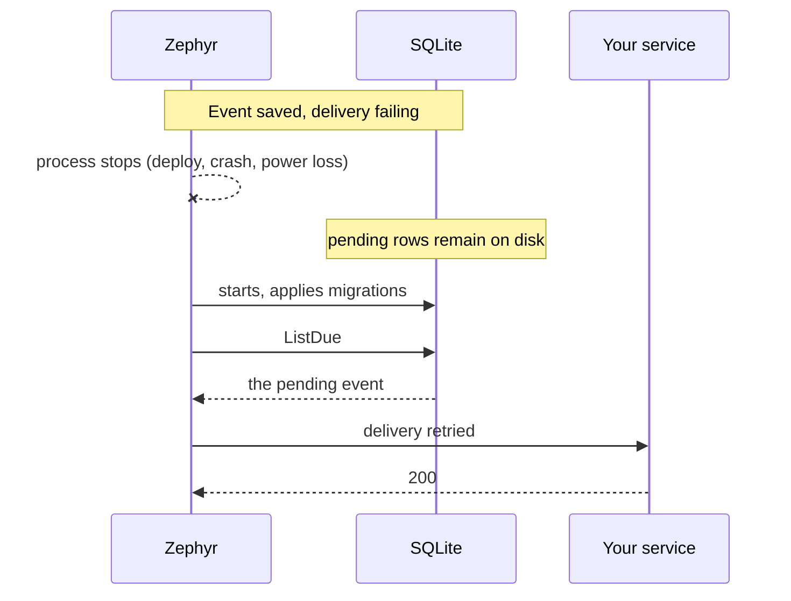

No manual recovery is needed. Keep the data volume (`/data` in Docker) on persistent storage, otherwise queued events are lost with the container.

## Flow 8: Meta cannot reach Zephyr

If Zephyr is stopped or the database fails during a webhook, Meta does not receive `200` and retries on its own schedule. When Zephyr returns, the retried webhooks are accepted and deduplicated. If the database is unavailable but the process is up, `/readyz` returns 503 and webhook requests answer 500, which is the signal for Meta to retry.

## Flow 9: How Zephyr answers each webhook request

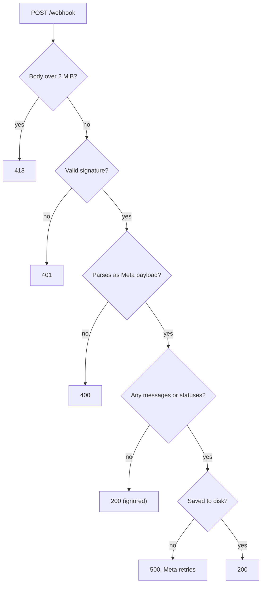

Every outcome is counted in `zephyr_webhook_requests_total{result=...}`.

## Flow 10: Handling a failed event

Events that exhaust their attempts stay in the outbox as `failed` for `FAILED_RETENTION` (7 days by default) and then are deleted. This release has no API to list or replay them. To inspect them, query the database:

```sh
sqlite3 data/gateway.db \
  "SELECT id, topic, attempts, last_error, datetime(updated_at/1000,'unixepoch') FROM outbox_entries WHERE state='failed'"
```

To retry a failed event, set it back to pending:

```sh
sqlite3 data/gateway.db \
  "UPDATE outbox_entries SET state='pending', attempts=0, next_attempt_at=0 WHERE id='evt_...'"
```

Do this with Zephyr stopped, or accept that it runs against a live database in WAL mode. A proper list and replay API is planned.

## Flow 11: Graceful shutdown

On `SIGTERM` or `Ctrl+C`, Zephyr logs `shutting down`, stops accepting new requests, lets in-flight requests finish (up to 30 seconds), stops the worker and janitor, then closes the database. An event whose delivery is interrupted stays pending and is retried on the next start.

## Flow 12: Tracing one message end to end

Take the `wamid` from your service or from Meta, then follow the `event_id`:

1. Search logs for `"wamid":"<wamid>"` and find `event received`. It shows the `request_id`, `event_id`, and whether it was `queued` or `duplicate`.
2. Search logs for the `event_id` to see every delivery attempt, its error, and finally `event delivered` with the time it took.
3. Use `request_id` to find the matching `request` log line with status and duration. The same ID is returned to the caller in the `X-Request-Id` response header.

See [telemetry.md](telemetry.md) for the full field list and metrics.

## Flow 13: Your service sends a message

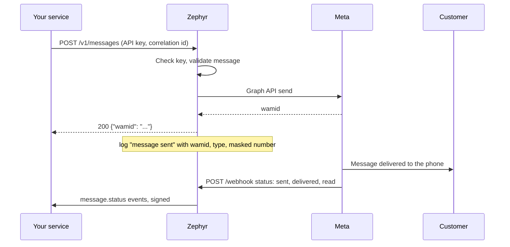

The `200` means Meta accepted the message, not that the phone received it. Delivery progress comes back through the normal inbound path as `message.status` events carrying the same `wamid`, so your service can match them to the send. A common pattern is a reply to an inbound message: take the sender from the `message.inbound` event's `data.from` and send within 24 hours.

## Flow 14: A send fails

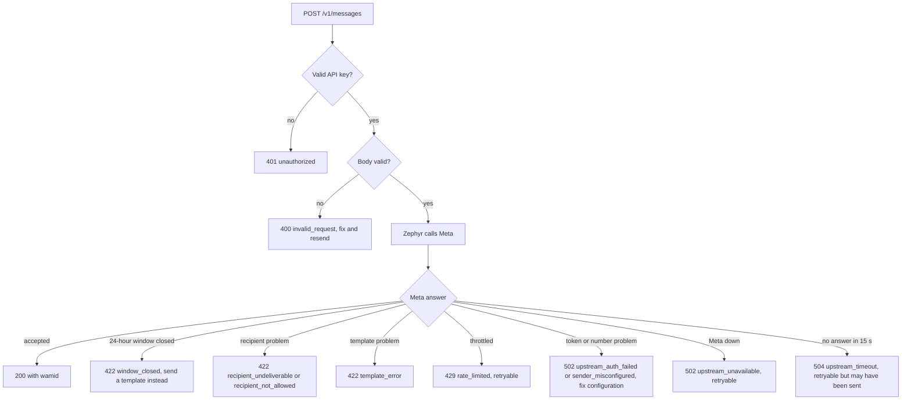

Retry only when `retryable` is true. With an `Idempotency-Key` the retry is safe (flow 16). Without one, be careful with `upstream_timeout`: Meta may have accepted the message even though no answer arrived, so a blind retry can send it twice. Every failure is logged with the Meta error code and its trace ID, which Meta support can use. See [api.md](api.md) for the full table.

## Flow 15: Reaching a customer after 24 hours

WhatsApp lets you send free-form messages only within 24 hours of the customer's last message. After that, Meta rejects the send and Zephyr returns `422 window_closed`. Your service responds by sending an approved template message instead:

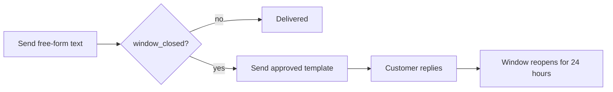

Zephyr does not track the window itself, so the first rejected send is how your service learns it is closed. Your service can also track the time of the last `message.inbound` event per customer to avoid the failed call.

## Flow 16: Retrying a send safely

Your service sends an order confirmation and the connection drops before the response arrives. It cannot tell whether the customer was messaged.

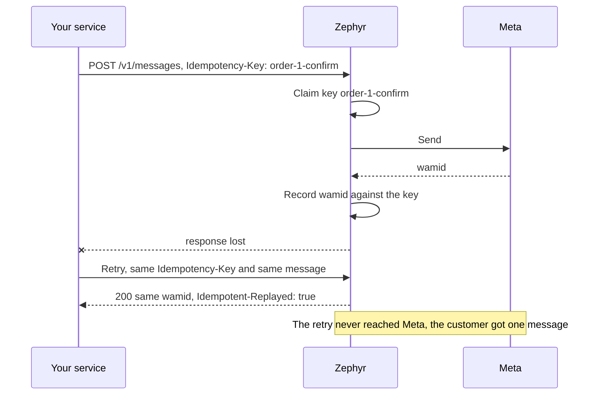

What your service sees on a retry depends on how the first attempt ended:

| First attempt                                  | Retry with the same key                                              |
| ---------------------------------------------- | -------------------------------------------------------------------- |
| Succeeded, response lost                       | `200` with the original `wamid` and `Idempotent-Replayed: true`      |
| Still running (slow Meta call)                 | `409 request_in_progress`. Wait a moment and retry again             |
| Failed with a Meta error                       | The key was released, so the retry sends for real and gets a fresh answer |
| Never reached Zephyr                           | Sends normally, since the key was never claimed                      |

Use one key per logical message and a different key for each new message. Reusing a key for a different message returns `422 idempotency_key_reused` so a bug on your side cannot silently drop a message.
